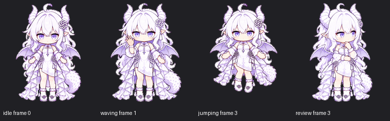

# gpt-pet · 霜铃

霜铃是一只白发紫瞳、带龙角与小翼的桌宠。本仓库保存她的精灵图、动作预览、生成提示、参考素材和制作验收记录。

当前仓库已收录初版与 `clarity-v2` 清晰版。下方图片与下载入口均对应 `clarity-v2`。

## 实际素材预览

以下图片直接复制自项目已有的验收预览，未为 README 重新生成、重绘或美化。角色素材本身由 AI 生成；这里展示的是已制作精灵图的实际帧，并非实拍照片或宿主应用截图。

| 待机 | 挥手 | 跳跃 |
| --- | --- | --- |
|  |  |  |



动图与静帧来源：[原始预览目录](Pets/frostbell/clarity-v2/qa/previews-clear/)。GIF/MP4 使用验收演示时序，不代表宿主应用实际播放帧率。静帧保留原有深色背景和帧标签，便于观察透明边缘与动作。

## 查看与下载

- [清晰版透明精灵图 PNG](Pets/frostbell/clarity-v2/final/spritesheet-clear.png)
- [备用无损 WebP](Pets/frostbell/clarity-v2/final/spritesheet-clear.webp)
- [完整动作 GIF](Pets/frostbell/clarity-v2/qa/previews-clear/all-states.gif)
- [十六方向视线预览](Pets/frostbell/clarity-v2/qa/previews-clear/look-loop.gif)
- [清晰版制作说明](Pets/frostbell/clarity-v2/STATUS.md)

在 GitHub 中打开图片后，可通过 **Raw / Download raw file** 保存原文件。也可以克隆整个素材仓库：

```sh
git clone https://github.com/ycc018/gpt-pet.git
```

本仓库提供素材和制作记录，不包含独立桌宠播放器或一键安装程序。`pet.json` 是制作时的身份与文件记录，不是安装配置；其中的绝对路径对应原制作环境，下载后请以本仓库相对路径查找文件。

## 精灵图信息

| 项目 | 内容 |
| --- | --- |
| 文件 | `Pets/frostbell/clarity-v2/final/spritesheet-clear.png` |
| 图集尺寸 | 1536 × 2288 像素，透明 PNG |
| 单格尺寸 | 192 × 208 像素 |
| 标准动作 | 待机、向右移动、向左移动、挥手、跳跃、失败、审阅、运行、等待，共九组 |
| 视线 | 十六个方向 |
| SHA256 | `d63a38962953803f943d612d197fc0447b05de70e5bc31ba4164f661076ab150` |

## 文件结构

```text
Pets/frostbell/
├── STATUS.md          # 制作记录
├── pet.json           # 桌宠身份与精灵图记录
├── final/             # 初版精灵图与验证结果
├── prompts/           # 初版生成提示
├── references/        # 参考图与布局资料
├── qa/                # 初版质量检查与预览
└── clarity-v2/
    ├── STATUS.md      # 清晰度修订说明
    ├── final/         # 清晰版精灵图与验证结果
    ├── prompts/       # 修订提示
    ├── references/    # 修订参考
    └── qa/            # 修订检查与预览
docs/images/           # README 展示用的原样预览副本
```

`.pet-deps/` 为本地制作依赖目录，已通过 `.gitignore` 排除。

## 验证与已知限制

清晰版的检查报告保存在 [qa](Pets/frostbell/clarity-v2/qa/) 与 [final](Pets/frostbell/clarity-v2/final/)，包括逐帧检查、方向审核与格式验证。具体结果及人工复核说明见 [制作记录](Pets/frostbell/clarity-v2/STATUS.md)。

原生单格分辨率为 192 × 208，放大不会增加真实细节。部分相邻视线变化较细微，跳跃峰值稍晚；清晰版主要改善轮廓、五官辨识度和边缘提取。
